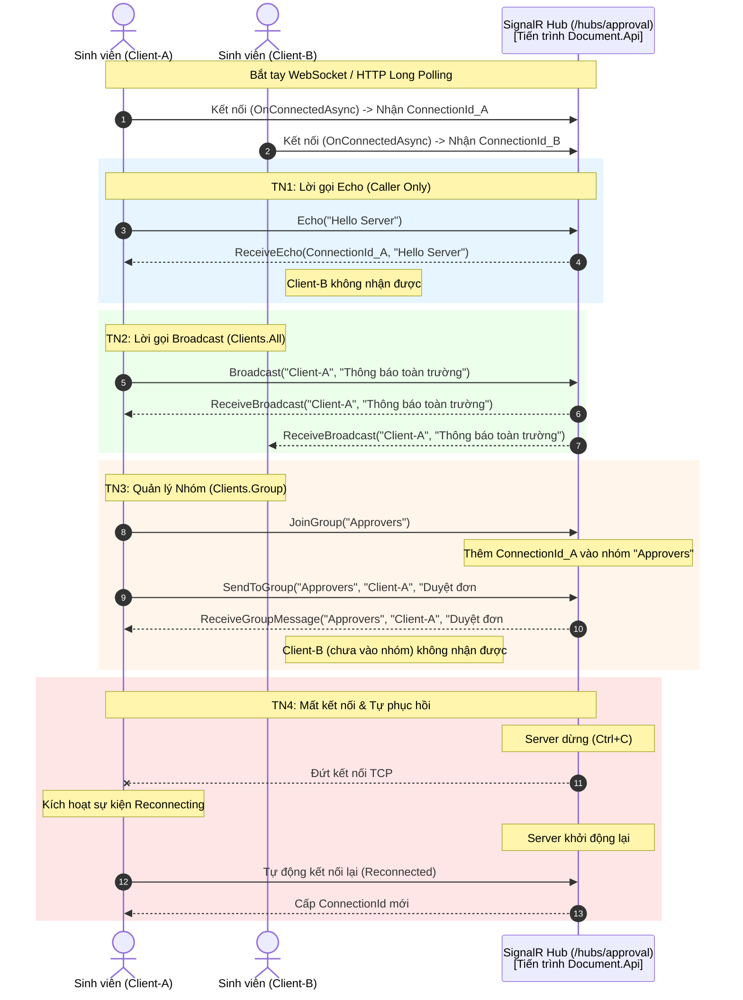

# BÁO CÁO THỰC HÀNH 3.2 – PHẦN A: SIGNALR THỜI GIAN THỰC
## HỆ THỐNG PHÊ DUYỆT TÀI LIỆU PHÂN TÁN (DOCUMENT APPROVAL REALTIME SYSTEM)

- **Học phần:** Phát triển ứng dụng phân tán
- **Nền tảng:** ASP.NET Core Minimal API & SignalR — .NET 10 (C#)
- **Đề tài:** Đề tài 12 — Quản lý quy trình gửi và phê duyệt tài liệu thời gian thực
- **Repository GitHub:** [https://github.com/dtc245200232/He_thong_phe_duyet_tai_lieu-De12.git](https://github.com/dtc245200232/He_thong_phe_duyet_tai_lieu-De12.git)

---

## PHẦN 1. TỔNG QUAN KIẾN TRÚC & HƯỚNG DẪN CHẠY

### 1.1. Cấu trúc Solution
```text
DocumentApproval/
├── Document.sln                 # Solution quản lý toàn bộ bài tập
├── nuget.config                 # Nguồn gói NuGet chính thức
├── .gitignore                   # Loại trừ file tạm, cache, bin/obj
├── README.md                    # Báo cáo thực hành chi tiết (2.2 & 3.2)
├── Document.Api/                # Web API & SignalR Hub (ASP.NET Core .NET 10)
│   ├── Document.Api.csproj
│   └── Program.cs               # Minimal API, ApprovalHub (/hubs/approval), In-memory List, DTOs
└── Document.Client/             # Máy khách SignalR & REST (Console Client .NET 10)
    ├── Document.Client.csproj   # Tích hợp Microsoft.AspNetCore.SignalR.Client
    └── Program.cs               # Xử lý HubConnection, On/Invoke, Reconnect, Menu tương tác
```

### 1.2. Hướng dẫn khởi chạy và thử nghiệm với nhiều Client (2-3 Terminal)

#### Bước 1: Khởi chạy API Server & SignalR Hub (Terminal 1)
```powershell
dotnet run --project Document.Api --urls http://localhost:5100
```
- Máy chủ lắng nghe HTTP và WebSocket tại: `http://localhost:5100`
- Tuyến SignalR Hub: `http://localhost:5100/hubs/approval`
- Giữ Terminal này tiếp tục hoạt động.

#### Bước 2: Chạy Client thứ nhất (Terminal 2)
```powershell
dotnet run --project Document.Client -- http://localhost:5100 Client-A auto
```
- Client-A sẽ tự động kết nối SignalR Hub, gọi Echo (TN1), gửi Broadcast (TN2), tham gia nhóm `Approvers` và gửi tin nhắn nhóm (TN3).

#### Bước 3: Chạy Client thứ hai (Terminal 3 - để quan sát Broadcast & Group)
```powershell
dotnet run --project Document.Client -- http://localhost:5100 Client-B interactive
```
- Client-B chạy ở chế độ tương tác (Interactive). Bạn có thể chọn tham gia nhóm `Approvers` hoặc gửi Broadcast để thấy lập tức Client-A ở Terminal 2 nhận được thông điệp thời gian thực!

---

## PHẦN 2. KIỂM THỬ CÓ CHỦ ĐÍCH (TN1 – TN4)

### Bảng Tổng Hợp 4 Tình Huống Thử Nghiệm SignalR

| Tình huống | Dự đoán trước khi chạy | Thao tác & Dữ liệu vào | Kết quả thực tế quan sát được | Vị trí mã nguồn giải thích hiện tượng | Nhận xét & Giải thích (tối thiểu 2–3 câu) |
| :--- | :--- | :--- | :--- | :--- | :--- |
| **TN1: Kết nối Hub và Echo (Caller Only)** | Máy khách kết nối thành công tới Hub, nhận `ConnectionId`. Khi gọi `Echo`, máy chủ chỉ phản hồi riêng cho chính máy khách đó, các máy khách khác không nhận được. | - Client gọi `hub.InvokeAsync("Echo", "Tin nhắn kiểm thử Echo")`.<br>- Lắng nghe sự kiện `ReceiveEcho`. | - Kết nối thành công, in ra `ConnectionId` (ví dụ: `XyZ123...`).<br>- Client nhận sự kiện `ReceiveEcho` với đúng nội dung chuỗi đã gửi.<br>- Terminal của client khác hoàn toàn không nhận được tin này. | `Document.Api/Program.cs`:<br>- Dòng 213-217:<br>`public async Task Echo(string message)`<br>`{ await Clients.Caller.SendAsync("ReceiveEcho", Context.ConnectionId, message); }` | Phương thức `Clients.Caller` chỉ định đích đến của gói tin thời gian thực chỉ duy nhất là kết nối vừa gửi yêu cầu lên. Điều này giúp bảo mật thông tin và tiết kiệm băng thông khi xử lý các phản hồi riêng tư giữa máy chủ và một máy khách cụ thể. Sự kiện `OnConnectedAsync` trên Hub cũng tự động ghi nhận `ConnectionId` duy nhất cho mỗi phiên kết nối. |
| **TN2: Hai Client và Broadcast (All Clients)** | Khi một client (ví dụ Client-A) gọi hàm `Broadcast`, **tất cả mọi client** đang duy trì kết nối tới Hub đều lập tức nhận được thông điệp cùng lúc. | - Mở 2 terminal chạy Client-A và Client-B.<br>- Client-A gọi `hub.InvokeAsync("Broadcast", "Client-A", "Thông báo họp...")`.<br>- Cả 2 client cùng lắng nghe `ReceiveBroadcast`. | - Cả Terminal của Client-A và Client-B đều hiển thị thông điệp màu xanh lá:<br>`<< [SIGNALR BROADCAST (TN2)] [Phát tới Tất Cả Client] Từ 'Client-A': Thông báo họp...` | `Document.Api/Program.cs`:<br>- Dòng 220-224:<br>`public async Task Broadcast(string sender, string message)`<br>`{ await Clients.All.SendAsync("ReceiveBroadcast", sender, message); }` | Đối tượng `Clients.All` đóng vai trò là kênh phát sóng diện rộng (broadcasting) tới toàn bộ các kết nối đang hoạt động trong Hub. Cơ chế này đặc biệt phù hợp cho các thông báo toàn hệ thống, như thông báo khi có một tài liệu quan trọng được phê duyệt hoặc thay đổi chính sách chung. Các máy khách nhận được dữ liệu gần như tức thời nhờ giao thức WebSocket 2 chiều (full-duplex). |
| **TN3: Quản lý nhóm (Groups: Join & SendToGroup)** | - Chỉ những máy khách đã gọi `JoinGroup("Approvers")` mới nhận được thông điệp gửi tới nhóm đó.<br>- Máy khách chưa tham gia nhóm sẽ không nhận được. | 1. Client-A gọi `JoinGroup("Approvers")`.<br>2. Client-B chưa tham gia nhóm `Approvers`.<br>3. Client-A gọi `SendToGroup("Approvers", ...)` gửi tin nhắn nhóm. | - Client-A nhận được tin nhắn nhóm `ReceiveGroupMessage`.<br>- Client-B hoàn toàn không nhận được tin nhắn này.<br>- Khi Client-B chọn tham gia nhóm `Approvers`, các tin nhắn gửi tới nhóm sau đó Client-B đều nhận được đầy đủ. | `Document.Api/Program.cs`:<br>- Dòng 227-248:<br>`Groups.AddToGroupAsync(Context.ConnectionId, groupName);`<br>`Clients.Group(groupName).SendAsync("ReceiveGroupMessage", ...);` | Quản lý nhóm (SignalR Groups) cho phép phân vùng người nhận theo vai trò nghiệp vụ (như Người phê duyệt `Approvers`, Người soạn thảo `Creators`). Máy chủ lưu trữ danh sách ConnectionId của từng nhóm trong bộ nhớ mà không cần lưu vào CSDL, giúp tối ưu hóa hiệu năng gửi tin mục tiêu. Khi một tài liệu được gửi duyệt (`/submit`), hệ thống chỉ phát thông báo đến nhóm `Approvers`, tránh làm phiền các người dùng khác. |
| **TN4: Mất kết nối & Tự động phục hồi (Reconnection)** | Khi dừng máy chủ API, Client sẽ kích hoạt sự kiện `Reconnecting`. Khi khởi động lại máy chủ, Client tự động phục hồi kết nối (`Reconnected`) mà không cần chạy lại ứng dụng. | 1. Hai Client đang chạy bình thường.<br>2. Tại Terminal 1 (API), nhấn `Ctrl + C` để tắt máy chủ.<br>3. Chờ 3 giây, sau đó gõ lệnh bật lại API server. | - Khi API tắt: Client in cảnh báo màu vàng:<br>`[CẢNH BÁO MẤT KẾT NỐI - TN4] Đang thử kết nối lại tự động (Reconnecting)...`<br>- Khi API bật lại: Client lập tức in thông báo màu xanh:<br>`[PHỤC HỒI THÀNH CÔNG - TN4] Đã kết nối lại thành công! ConnectionId mới: ...` | `Document.Client/Program.cs`:<br>- Dòng 25:<br>`.WithAutomaticReconnect(...)`<br>- Dòng 28-49:<br>`hubConnection.Reconnecting += ...`<br>`hubConnection.Reconnected += ...` | Nhờ cấu hình `.WithAutomaticReconnect()`, SignalR Client triển khai thuật toán thử lại với thời gian chờ tăng dần (backoff), liên tục kiểm tra tính sẵn sàng của máy chủ. Khi máy chủ hoạt động trở lại, client tự động đàm phán lại bắt tay WebSocket và được cấp một `ConnectionId` mới mà không làm gián đoạn trải nghiệm của người dùng. Nếu máy chủ tắt quá thời gian tối đa, sự kiện `Closed` sẽ được kích hoạt để thông báo kết nối đã bị chấm dứt hoàn toàn. |

---

## PHẦN 3. ĐIỀU CHỈNH NHỎ VÀ CHẠY LẠI

### Thay đổi 1: Sửa nội dung chuỗi gửi bởi Broadcast
- **Vị trí chỉnh sửa:** Tệp `Document.Client/Program.cs`, tại hàm `RunAutomatedTestsAsync` (khoảng dòng 135).
  - *Trước khi sửa:* `await hub.InvokeAsync("Broadcast", name, "Cuộc họp phê duyệt tài liệu sẽ bắt đầu lúc 14h00.");`
  - *Sau khi sửa:* `await hub.InvokeAsync("Broadcast", name, "Hệ thống phê duyệt tài liệu sẽ bảo trì vào lúc 22h00 tối nay.");`
- **Ca kiểm thử chứng minh tác động:**
  - Mở Terminal 1 (API) và Terminal 2 (Client-B interactive).
  - Tại Terminal 3, chạy Client-A: `dotnet run --project Document.Client -- http://localhost:5100 Client-A auto`.
  - **Kết quả quan sát:** Trên màn hình của cả Client-A và Client-B đều hiển thị nội dung thông báo mới: `"Hệ thống phê duyệt tài liệu sẽ bảo trì vào lúc 22h00 tối nay."`.

### Thay đổi 2: Đổi tên nhóm hoặc gửi thông điệp tới nhóm mới
- **Vị trí chỉnh sửa:** Tệp `Document.Client/Program.cs`, tại phần kiểm thử nhóm TN3 (khoảng dòng 141).
  - *Trước khi sửa:* Tên nhóm là `"Approvers"`, tin nhắn `"Kính nhờ các anh/chị xem xét hồ sơ mới vừa gửi."`
  - *Sau khi sửa:* Tên nhóm là `"BanGiamHieu"`, tin nhắn `"Kính gửi Ban Giám hiệu phê duyệt báo cáo kiểm toán năm 2026."`
- **Ca kiểm thử chứng minh tác động:**
  - Chạy Client-A với nhóm `"BanGiamHieu"`.
  - Mở Client-B tham gia nhóm `"Creators"` (không tham gia `"BanGiamHieu"`).
  - **Kết quả quan sát:** Client-A nhận được tin nhắn nhóm, trong khi Client-B hoàn toàn không nhận được do không thuộc nhóm `"BanGiamHieu"`.

---

## PHẦN 4. GIẢI THÍCH VÀ BÁO CÁO TỔNG HỢP

### 4.1. Sơ đồ các tiến trình tham gia và đường đi dữ liệu SignalR


### 4.2. Phân biệt: Thông điệp nào gửi cho Caller, All và Group?
1. **`Clients.Caller` (Chỉ gửi cho người gọi):**
   - Chỉ trả thông điệp về duy nhất cho kết nối vừa gọi phương thức Hub.
   - Thường áp dụng cho: Phản hồi kết quả của một thao tác cá nhân, xác nhận đăng nhập/tham gia nhóm, kiểm tra độ trễ (ping/echo), hoặc gửi thông báo lỗi nghiệp vụ riêng tư.
2. **`Clients.All` (Gửi cho tất cả mọi người):**
   - Phát sóng thông điệp tới toàn bộ các kết nối đang online trên Hub.
   - Thường áp dụng cho: Thông báo sự kiện toàn hệ thống (ví dụ: thông báo bảo trì, thông báo tài liệu mới được ban hành công khai cho toàn thể nhân viên).
3. **`Clients.Group(groupName)` (Gửi cho nhóm mục tiêu):**
   - Chỉ chuyển phát thông điệp tới các kết nối đã đăng ký gia nhập nhóm `groupName`.
   - Thường áp dụng cho: Phân quyền vai trò nghiệp vụ (như gửi thông báo tài liệu chờ duyệt tới nhóm `Approvers`, thông báo tài liệu bị từ chối tới nhóm `Creators`, hoặc nhóm trao đổi của một phòng ban cụ thể).

### 4.3. Điều gì xảy ra với kết nối khi Hub dừng hoạt động?
1. **Ở tầng mạng (TCP / WebSocket):**
   - Khi tiến trình máy chủ bị ngắt (`Ctrl+C` hoặc sự cố máy chủ), socket TCP bị đóng đột ngột. Máy khách không còn nhận được các gói tin giữ kết nối (ping/keep-alive packet).
2. **Ở tầng ứng dụng phía Client (`HubConnection`):**
   - Máy khách phát hiện mất kết nối và lập tức kích hoạt sự kiện **`Reconnecting`**.
   - Nếu có cấu hình `.WithAutomaticReconnect()`, Client sẽ tự động chạy cơ chế thử lại (Retry loop) sau các khoảng thời gian được định nghĩa trước (ví dụ: 0s, 2s, 5s, 10s,...).
   - Nếu máy chủ bật lại kịp thời trong các khoảng thử lại này, kết nối sẽ được tái lập thành công, sự kiện **`Reconnected`** được kích hoạt và máy khách nhận một `ConnectionId` mới.
   - Nếu máy chủ vẫn không hoạt động sau tất cả các lần thử lại, kết nối sẽ bị hủy và sự kiện **`Closed`** được kích hoạt để giải phóng tài nguyên.
