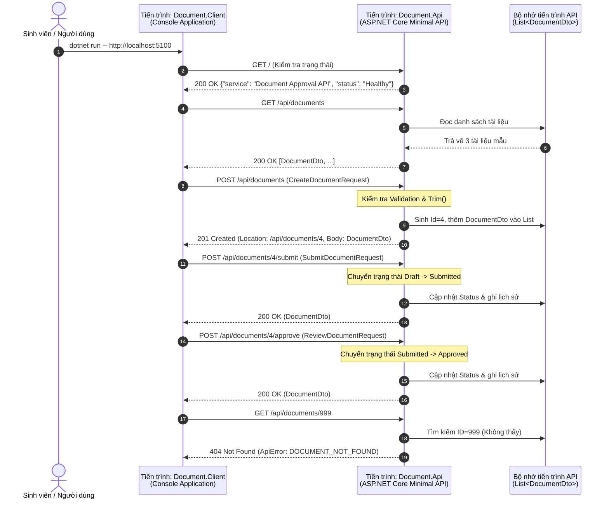

# BÁO CÁO THỰC HÀNH 2.2 – PHẦN A: ĐỌC HIỂU VÀ THỬ NGHIỆM
## HỆ THỐNG PHÊ DUYỆT TÀI LIỆU PHÂN TÁN (DOCUMENT APPROVAL API & CLIENT)

- **Học phần:** Phát triển ứng dụng phân tán
- **Nền tảng:** ASP.NET Core Minimal API — .NET 10 (C#)
- **Đề tài:** Đề tài 12 — Quản lý quy trình gửi và phê duyệt tài liệu
- **Repository GitHub:** [https://github.com/dtc245200232/He_thong_phe_duyet_tai_lieu-De12.git](https://github.com/dtc245200232/He_thong_phe_duyet_tai_lieu-De12.git)

---

## PHẦN 1. TÁI TẠO ỨNG DỤNG MẪU

### 1.1. Cấu trúc Solution và các dự án
Dự án được khởi tạo và tổ chức gồm Solution và hai dự án độc lập:
```text
DocumentApproval/
├── Document.sln             # Solution quản lý toàn bộ bài tập
├── nuget.config             # Nguồn gói NuGet chính thức
├── .gitignore               # Loại trừ file tạm, cache, thư mục bin/obj
├── README.md                # Báo cáo kết quả thực hành và giải thích chi tiết
├── Document.Api/            # Dự án Web API (ASP.NET Core Minimal API - .NET 10)
│   ├── Document.Api.csproj
│   └── Program.cs           # Minimal API endpoints, In-memory List, DTOs, ApiError
└── Document.Client/         # Dự án Máy khách (Console Client - .NET 10)
    ├── Document.Client.csproj
    └── Program.cs           # HttpClient gọi tuần tự các kịch bản thử nghiệm
```

### 1.2. Hướng dẫn biên dịch và khởi chạy
- **Biên dịch Solution:**
  ```powershell
  dotnet build Document.sln
  ```
- **Khởi chạy API Server (Terminal 1):**
  ```powershell
  dotnet run --project Document.Api --urls http://localhost:5100
  ```
- **Khởi chạy Console Client (Terminal 2):**
  ```powershell
  dotnet run --project Document.Client -- http://localhost:5100
  ```

---

## PHẦN 2. KIỂM THỬ CÓ CHỦ ĐÍCH (TN1 – TN4)

### Bảng Tổng Hợp 4 Tình Huống Thử Nghiệm

| Tình huống | Dự đoán trước khi chạy | Thao tác & Dữ liệu vào | Kết quả thực tế quan sát được | Vị trí mã nguồn giải thích hiện tượng | Nhận xét & Giải thích (2-3 câu) |
| :--- | :--- | :--- | :--- | :--- | :--- |
| **TN1: Truy xuất tài nguyên** | - `GET /api/documents` trả mã 200 và danh sách 3 tài liệu.<br>- `GET /api/documents/1` trả 200 và thông tin tài liệu 1.<br>- `GET /api/documents/999` trả 404 Not Found kèm `ApiError`. | - Gọi `GET /api/documents`<br>- Gọi `GET /api/documents/1`<br>- Gọi `GET /api/documents/999` | - `GET /api/documents` $\rightarrow$ `200 OK`, body chứa 3 tài liệu.<br>- `GET /api/documents/1` $\rightarrow$ `200 OK`, body chứa chi tiết ID=1.<br>- `GET /api/documents/999` $\rightarrow$ `404 Not Found`, body: `{"code":"DOCUMENT_NOT_FOUND","message":"Không tìm thấy tài liệu có mã ID: 999."}` | `Document.Api/Program.cs`:<br>- Dòng 57: `documentApi.MapGet("/", ...)`<br>- Dòng 89-96: `documentApi.MapGet("/{id:int}", ...)` kiểm tra `if (doc is null) return Results.NotFound(...)` | Mã 200 trả về khi máy chủ định tuyến thành công và tìm thấy tài nguyên tương ứng trong bộ nhớ. Mã 404 trả về khi định dạng tuyến đúng kiểu `:int` nhưng hàm tìm kiếm `FirstOrDefault` không thấy phần tử nào có ID tương ứng. Cấu trúc lỗi `ApiError` giúp client nhận biết rõ nguyên nhân lỗi thay vì nhận trang HTML mặc định. |
| **TN2: Tạo mới bằng POST** | Máy chủ tạo tài liệu mới, tự sinh `Id = 4`, trả về HTTP status `201 Created`, header `Location: /api/documents/4` và body chứa tài liệu mới ở trạng thái `Draft`. | Gửi `POST /api/documents`<br>Body JSON:<br>`{"title":"Đơn xin cấp kinh phí...","content":"Kính gửi...","createdBy":"nguyenvana","assignedApprover":"tranvanb"}` | - Mã trạng thái: `201 Created`.<br>- Header `Location`: `/api/documents/4`.<br>- Body: ID=4, trạng thái `Draft`, có 1 bước lịch sử `Created`.<br>- Gọi GET theo URI `/api/documents/4` đọc lại đúng tài liệu vừa tạo. | `Document.Api/Program.cs`:<br>- Dòng 101-137: `documentApi.MapPost("/", ...)`<br>- Dòng 115: `var nextId = documents.Count > 0 ? documents.Max(d => d.Id) + 1 : 1;`<br>- Dòng 136: `return Results.Created($"/api/documents/{newDoc.Id}", newDoc);` | Máy chủ tự động sinh Id tiếp theo (`currentMax + 1`) để đảm bảo tính duy nhất và không cho client can thiệp Id. Trả về mã 201 Created kèm header `Location` đúng theo chuẩn RFC HTTP để chỉ ra địa chỉ tài nguyên mới được tạo. Thao tác GET kiểm chứng ngay sau đó xác nhận dữ liệu đã được lưu trữ thành công vào danh sách. |
| **TN3: Kiểm tra dữ liệu (Validation & Trim)** | - Gửi tiêu đề rỗng sẽ bị từ chối với mã `400 Bad Request` và `ApiError: INVALID_DOCUMENT`.<br>- Gửi tiêu đề có khoảng trắng thừa sẽ được tạo thành công và server tự động cắt tỉa (`Trim`) sạch khoảng trắng. | 1. POST tiêu đề rỗng: `{"title":"","createdBy":"nguyenvana"}`<br>2. POST khoảng trắng thừa: `{"title":"   Đề xuất trang bị bảng vẽ điện tử   ","createdBy":"   nguyenvana   "}` | - Tình huống 1: Mã `400 Bad Request`, body: `{"code":"INVALID_DOCUMENT","message":"Tiêu đề tài liệu không được để trống..."}`.<br>- Tình huống 2: Mã `201 Created`. Tiêu đề sau khi tạo: `"Đề xuất trang bị bảng vẽ điện tử"`, Người tạo: `"nguyenvana"` (đã mất toàn bộ khoảng trắng thừa). | `Document.Api/Program.cs`:<br>- Dòng 104: `if (string.IsNullOrWhiteSpace(request.Title)) return Results.BadRequest(...)`<br>- Dòng 118: `Title: request.Title.Trim()`, `CreatedBy: request.CreatedBy.Trim()` | Hàm `string.IsNullOrWhiteSpace` chặn đứng các chuỗi rỗng hoặc chỉ toàn phím cách, bảo vệ tính đúng đắn của dữ liệu đầu vào. Việc áp dụng `.Trim()` ở tầng xử lý dữ liệu trước khi thêm vào danh sách giúp chuẩn hóa chuỗi, tránh tình trạng sai lệch khi tìm kiếm hoặc hiển thị trên giao diện người dùng. |
| **TN4: Lỗi phía client & Phân biệt ngoại lệ** | - Khi API đang chạy: Client kết nối thành công, nhận các mã HTTP status từ server.<br>- Khi dừng API: Client văng ra ngoại lệ mất kết nối tầng mạng (`HttpRequestException`). | 1. Chạy Client khi API đang mở.<br>2. Nhấn `Ctrl+C` tắt API ở Terminal 1, sau đó chạy lại Client ở Terminal 2. | - Khi API chạy: Client thực thi bình thường tất cả các bước, nhận HTTP 200, 201, 400, 404.<br>- Khi API dừng: Client không nhận được mã HTTP nào, văng ngoại lệ: `System.Net.Http.HttpRequestException: No connection could be made because the target machine actively refused it. (localhost:5100)`. | `Document.Client/Program.cs`:<br>- Dòng 181-187: khối `catch (HttpRequestException ex)` bắt lỗi mất kết nối ở tầng mạng. | Khi API đang chạy và trả về lỗi 400 Bad Request, kết nối TCP/HTTP vẫn hoàn toàn thành công; máy chủ chủ động phản hồi một gói tin HTTP kèm đối tượng `ApiError`. Ngược lại, khi máy chủ bị dừng, bắt tay TCP thất bại nên `HttpClient` ném ra ngoại lệ ở tầng mạng (Socket Exception), hoàn toàn không có mã trạng thái HTTP hay dữ liệu phản hồi nào từ máy chủ. |

---

## PHẦN 3. ĐIỀU CHỈNH NHỎ VÀ CHẠY LẠI

### Thay đổi 1: Đổi tên một phần tử dữ liệu mẫu trong API
- **Vị trí chỉnh sửa:** Tệp `Document.Api/Program.cs`, tại định nghĩa tài liệu mẫu số 1 (khoảng dòng 15).
  - *Trước khi sửa:* `Title: "Kế hoạch nâng cấp hệ thống máy chủ phòng thực hành"`
  - *Sau khi sửa:* `Title: "Kế hoạch nâng cấp phòng máy chủ Cloud Lab 2026"`
- **Ca kiểm thử chứng minh tác động:**
  - Chạy lại API và mở trình duyệt truy cập: `http://localhost:5100/api/documents/1`.
  - **Kết quả quan sát:** Thuộc tính `title` trả về đổi thành `"Kế hoạch nâng cấp phòng máy chủ Cloud Lab 2026"`. Các trường khác (`status: "Draft"`, `createdBy: "nguyenvana"`) vẫn giữ nguyên tính toàn vẹn.

### Thay đổi 2: Đổi nội dung tài liệu mà Client gửi trong POST
- **Vị trí chỉnh sửa:** Tệp `Document.Client/Program.cs`, tại phần khởi tạo `newDocRequest` của Thử nghiệm 2 (khoảng dòng 68).
  - *Trước khi sửa:* `Title: "Đơn xin cấp kinh phí thực tập tốt nghiệp năm 2026"`
  - *Sau khi sửa:* `Title: "Đề xuất tổ chức cuộc thi Lập trình phân tán Hackathon 2026"`
- **Ca kiểm thử chứng minh tác động:**
  - Chạy lại Client: `dotnet run --project Document.Client -- http://localhost:5100`.
  - **Kết quả quan sát:**
    - Yêu cầu POST tạo mới gửi tiêu đề mới `"Đề xuất tổ chức cuộc thi Lập trình phân tán Hackathon 2026"`.
    - Máy chủ phản hồi mã `201 Created` với header `Location: /api/documents/4`.
    - Lời gọi GET kiểm chứng ngay sau đó hiển thị đúng tiêu đề mới đã được lưu trên máy chủ.

---

## PHẦN 4. GIẢI THÍCH VÀ BÁO CÁO TỔNG HỢP

### 4.1. Sơ đồ các tiến trình tham gia và đường đi dữ liệu


### 4.2. Khác biệt giữa `DocumentDto` và `CreateDocumentRequest`
1. **Mục đích sử dụng:**
   - `CreateDocumentRequest` là **DTO đầu vào (Input DTO)**: Đại diện cho dữ liệu mà máy khách (Client) gửi lên khi muốn tạo một tài liệu mới.
   - `DocumentDto` là **DTO đầu ra (Output DTO)**: Đại diện cho thông tin tài nguyên hoàn chỉnh mà máy chủ trả về cho máy khách xem hoặc lưu trữ.
2. **Khác biệt về các trường dữ liệu:**
   - `CreateDocumentRequest` chỉ chứa các thông tin người dùng được phép cung cấp: `Title`, `Content`, `CreatedBy`, `AssignedApprover`.
   - `DocumentDto` bao gồm tất cả các thông tin do hệ thống tự sinh và quản lý: `Id` (khóa chính), `Status` (trạng thái vòng đời), `CreatedAt` (thời điểm tạo), `UpdatedAt` (thời điểm sửa) và danh sách toàn bộ các bước lưu vết lịch sử `Histories`.
3. **Vì sao Client không được tự chọn ID?**
   - Khóa chính `Id` là định danh duy nhất của tài nguyên. Nếu cho phép Client tự chọn Id sẽ dễ dẫn đến xung đột trùng lặp khóa chính giữa nhiều Client khác nhau, hoặc Client cố tình ghi đè tài nguyên của người khác. Máy chủ phải là nơi duy nhất kiểm soát việc sinh Id một cách an toàn và tuần tự.

### 4.3. Vì sao dữ liệu bị mất sau khi khởi động lại API?
- Trong bài thực hành này, dữ liệu tài liệu được lưu trong cấu trúc `List<DocumentDto>` nằm trực tiếp trên **Bộ nhớ trong (RAM / In-memory)** của tiến trình `Document.Api`.
- Bộ nhớ RAM có đặc tính khả biến (volatile): Khi tiến trình ứng dụng kết thúc (ví dụ nhấn `Ctrl+C` hoặc tắt terminal), toàn bộ không gian địa chỉ bộ nhớ của tiến trình đó bị hệ điều hành thu hồi.
- Khi khởi động lại máy chủ bằng `dotnet run`, hàm khởi tạo ứng dụng sẽ chạy lại từ đầu và gán lại `documents` bằng danh sách chứa đúng 3 phần tử mặc định ban đầu. Tất cả các tài liệu được thêm mới trong phiên chạy trước (ví dụ ID 4, 5) đều bị xóa sạch do chưa được ghi vào bộ nhớ lưu trữ bền vững (Persistent Storage) như Cơ sở dữ liệu phân tán PostgreSQL hay ổ đĩa.
